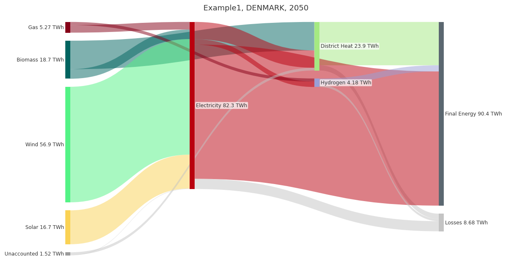
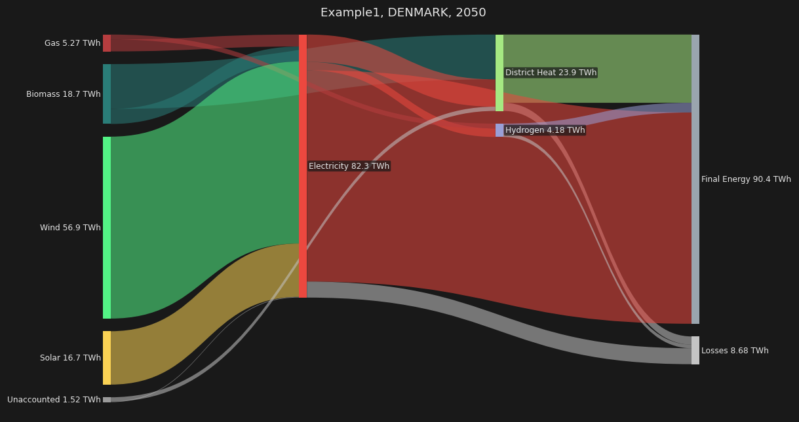
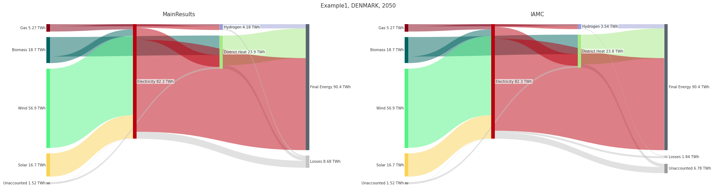

# Sankey Diagrams

A Sankey diagram shows where energy comes from, what it is turned into and
where it ends up, for one scenario and year. pybalmorel draws it from loaded
`MainResults`, or from IAMC data such as `MainResults.to_iamc` returns. Drawing
the two side by side shows what the IAMC conversion reports and what it leaves
out. Reading `MainResults` needs a GAMS installation.

## Quick start

```python
from pybalmorel import MainResults

results = MainResults('MainResults_Example1.gdx', paths='examples/files',
                      system_directory='/opt/gams/53')
fig, ax = results.plot_sankey(2050, countries='DENMARK')
```



Sources are on the left, commodities in the middle and where energy ends up
on the right. Each node is labelled with its size. Bands are coloured by the
node they come from, and losses are grey.

## What the diagram shows

The diagram is built with the same Mapping Rules as the IAMC conversion, so
both sides use the same names.

- **Sources** are the Fuel Categories of what units burn, such as Biomass,
  Gas or Wind. Units that burn a commodity, such as heat pumps or
  electrolysers, draw from that commodity's node instead.
- **Commodities** are Electricity, Heat, Hydrogen and Gases. Heat made in
  individual and industry areas goes to **On-site Heat**, because the IAMC
  data counts it as final energy rather than as centralized heat. In IAMC
  data, a use that Primary Energy is reported by is a commodity too. For
  example, **Liquids** holds the biomass that OptiFlow's biofuel plants take
  in.
- **Final Energy Sectors** such as Residential and Commercial or Industry
  receive the final demand whose sector Balmorel knows. All other final
  demand goes to **Final Energy**.
- **Imports** and **Exports** hold transmission into and out of the countries,
  regions or areas you chose, in each direction.
- **Losses** collects conversion losses, grid losses and storage losses.
- **Ambient Heat** is the heat that heat pumps take from their surroundings.
- **OptiFlow** appears when the results come from the OptiFlow add-on. It
  shows what OptiFlow takes from Balmorel's commodities, what the OptiFlow
  Mapping reports it taking from Sources as Primary Energy, and what the
  Mapping reports it giving back.
- **Unaccounted** balances each commodity. When more of a commodity flows in
  than out, or the other way round, the difference goes to or comes from
  Unaccounted. It shows what the data leaves out. In IAMC data, for example,
  it holds what electrolysers take in.

Each flow has a **Kind**:

| Kind | Meaning |
|---|---|
| `flow` | Energy a unit makes, or a commodity delivers |
| `loss` | What a conversion, grid or storage loses |
| `ambient` | Heat from the surroundings |
| `unaccounted` | What balances a commodity |

A unit's fuel input is split over what it makes in proportion to its output.
Losses are netted for each pair of Source and commodity, as in the IAMC data.

In IAMC data, the final energy of a carrier from a Source, such as
`Final Energy|Gases|Biomass`, comes from the commodity node up to the amount
that Source feeds into the commodity. Anything beyond that amount comes from
the Source directly. This way the same biomass is not drawn twice.

## How-to guides

### Choose countries, regions or areas

Pass one of `countries`, `regions` or `areas`. Each takes one name or a list
of names. Leave all three out to cover the whole model.

```python
results.plot_sankey(2050, regions='DK1')
results.plot_sankey(2050, areas=['DK1_Large', 'DK1_IDVU-HOTWTR'])
```

Balmorel balances electricity and hydrogen per region, not per area. When you
choose areas, the electricity and hydrogen those areas take in or send out
therefore appear as a **Grid** node. Imports and Exports then hold only heat.

With several scenarios loaded, choose one with `scenario`, by name or by
position. The default is the first.

### Change the unit

```python
results.plot_sankey(2050, countries='DENMARK', unit='PJ')
```

The units you can choose are TWh, GWh, MWh, PJ, TJ, GJ, EJ, Mtoe and ktoe,
each also with `/yr`.

### Draw it dark

```python
fig, ax = results.plot_sankey(2050, countries='DENMARK', dark=True)
fig.savefig('sankey_dark.png')
```



The dark style uses a near-black background and light text. Coal, Gas, Oil,
Biomass and Electricity are drawn lighter than their usual colours so they
show against it. `savefig` keeps the dark background.

### Show only part of the flows

`filter` is a [pandas query](https://pandas.pydata.org/docs/reference/api/pandas.DataFrame.query.html)
on the columns `From`, `To`, `Kind` and `Value`. Only the flows that match it
are drawn. Losses and Unaccounted are worked out before the filter applies.

```python
# Only what conversions make, without losses
results.plot_sankey(2050, countries='DENMARK', filter="Kind != 'loss'")

# Only what flows into or out of hydrogen
results.plot_sankey(2050, countries='DENMARK', filter="To == 'Hydrogen' or From == 'Hydrogen'")
```

`min_share` hides flows smaller than that share of the largest node. The
default is 0.001. Side by side, the largest node of either diagram sets the
limit, so both hide the same flows.

### Get the flows as a table

`sankey_flows` returns the table that the diagram draws. It takes the same
arguments as `plot_sankey`.

```python
flows = results.sankey_flows(2050, countries='DENMARK')
```

| From | To | Kind | Value |
|---|---|---|---|
| Biomass | Electricity | flow | 4.70 |
| Biomass | Heat | flow | 14.02 |
| Electricity | Final Energy | flow | 66.07 |
| ... | ... | ... | ... |

### Compare with the IAMC data

Pass the output of `to_iamc` as `iamc` to draw the two side by side at the
same scale:

```python
data, notes = results.to_iamc('Balmorel')
fig, axes = results.plot_sankey(2050, countries='DENMARK', iamc=data)
table = results.sankey_flows(2050, countries='DENMARK', iamc=data)
```



The table then has the columns `From`, `To`, `Kind`, `MainResults`, `IAMC`
and `Difference`. `Difference` is the IAMC value minus the MainResults value,
and a flow that only one side has is 0 on the other. IAMC data is reported per
country, so a comparison can only be made for countries.

The IAMC Scenario defaults to the Balmorel scenario's name. Choose another
with `iamc_scenario`. Pass `rules`, `optiflow` and `definitions` as you did to
`to_iamc`.

The two sides are meant to differ in some places:

- **Losses.** The IAMC data reports conversion losses only where it reports
  Primary Energy. Grid, storage and distribution losses therefore show as
  Unaccounted on the IAMC side. So do the conversion losses of heat units and
  electrolysers that burn electricity.
- **What electrolysers take in.** The IAMC data doesn't report it, so it shows
  as Unaccounted on the IAMC side.
- **Heat pumps.** The IAMC data counts all of a heat pump's heat as made from
  electricity. MainResults splits it into electricity and Ambient Heat.
- **Heat in individual and industry areas.** MainResults draws it through
  On-site Heat. The IAMC data reports the fuel burnt for it as final energy of
  the sector, and the electricity used for it as Final Energy.
- **Biomethane in power and heat plants.** The IAMC data counts electricity
  and district heat made from biomethane as made from biomass. MainResults
  draws them from Gases. On the IAMC side, the biomethane those plants burn
  shows as Unaccounted.
- **Biofuels made by OptiFlow.** The IAMC data reports the biomass that the
  plants take in and the biofuel that ships and aircraft use. It does not
  report what the plants make. On the IAMC side, the plants' conversion
  losses therefore show as Unaccounted from Liquids.
- **Trade.** MainResults shows imports and exports in each direction. The IAMC
  data reports net exports. Heat moved between district heating and
  individual or industry areas is netted over the year too, whereas
  MainResults shows it in each direction.
- **Nuclear.** MainResults shows its fuel input and losses. The IAMC data
  counts nuclear by what it makes (direct equivalent), so it has no losses.

What units make from each Source should agree on both sides. If it doesn't,
the IAMC conversion is missing something.

### Draw IAMC data or your own flows

`pybalmorel.plotting` has the functions behind the methods. `sankey_flows` also
reads IAMC data from any model. Pass it as a wide table with one column per
year, or as a table with `Year` and `Value` columns.

```python
from pybalmorel.plotting import sankey_flows, compare_sankey_flows, plot_sankey

flows = sankey_flows(iamc_data, 2050, scenario='SSP2', countries='Denmark')
fig, ax = plot_sankey(flows, unit='TWh', title='Denmark 2050')
```

`plot_sankey` draws any table with `From`, `To` and `Value` columns. The
`Kind` column is optional, and links of kind `loss` are drawn grey. A table
with several value columns, such as the one `compare_sankey_flows` returns,
gets one panel per column, all at the same scale. A flow that runs back to an
earlier column, such as hydrogen turned back into electricity, is drawn as a
loop below the diagram.
